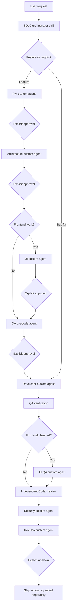

# Architecture: Portable Claude-to-Codex SDLC

## 1. Architecture Summary

The migration will use three Codex-native layers:

1. **Global policy:** a managed block for `~/.codex/AGENTS.md` containing stable SDLC rules that should apply in every repository.
2. **Workflow skills:** a top-level `sdlc` orchestrator plus independently discoverable utility skills under `~/.codex/skills/`.
3. **Custom agents:** role-specific TOML files under `~/.codex/agents/`, registered in `~/.codex/config.toml`, for PM, architecture, UI, development, QA, UI QA, security, and DevOps execution.

This preserves the source workflow more faithfully than representing every role only as a skill. Skills define when and how workflows run; custom agents provide isolated role instructions, tool/sandbox boundaries, and handoff outputs.

## 2. System Flow



## 3. Repository Layout

```text
codex-sdlc/
├── AGENTS.md
├── README.md
├── VERSION
├── install.sh
├── uninstall.sh
├── manifest.txt
├── config/
│   └── agents.toml
├── agents/
│   ├── sdlc-pm.toml
│   ├── sdlc-architect.toml
│   ├── sdlc-ui.toml
│   ├── sdlc-developer.toml
│   ├── sdlc-qa.toml
│   ├── sdlc-ui-qa.toml
│   ├── sdlc-security.toml
│   └── sdlc-devops.toml
├── skills/
│   ├── sdlc/
│   │   ├── SKILL.md
│   │   ├── agents/openai.yaml
│   │   └── references/
│   │       ├── phase-contracts.md
│   │       └── artifact-templates.md
│   ├── code-review/
│   ├── commit-message/
│   ├── debug/
│   └── ...
├── extensions/
│   ├── organization/
│   └── README.md
├── scripts/
│   ├── install-managed-block.py
│   ├── validate-package.sh
│   └── scan-secrets.sh
├── tests/
│   ├── installer-test.sh
│   ├── idempotency-test.sh
│   └── manifest-test.sh
└── docs/
    ├── prd/
    ├── arch/
    └── migration-matrix.md
```

Only directories with concrete content will be created. The layout may be introduced incrementally as each implementation phase needs it.

## 4. Component Contracts

### 4.1 Global `AGENTS.md` managed block

The package must not replace an existing global file. It owns only content between deterministic markers:

```text
<!-- codex-sdlc:start -->
...managed rules...
<!-- codex-sdlc:end -->
```

Installation behavior:

- No existing block: append the managed block after backing up the file.
- Existing block: replace that block only.
- No existing file: create it.
- Uninstall: remove only the managed block and leave all other content untouched.

The block contains phase ordering, approval words, artifact paths, branch conventions, fast-track rules, and definitions of done. Detailed role instructions stay in agent TOMLs to avoid loading unnecessary context globally.

### 4.2 `sdlc` orchestrator skill

Inputs:

- User request and repository context.
- Existing PRD/architecture/UI/test-plan artifacts, when present.
- Current Git branch and changed paths.

Responsibilities:

- Classify feature versus bug fix; ask only when evidence cannot resolve it.
- Determine current phase from artifacts and conversation state.
- Spawn exactly the role required for the current phase.
- Relay agent output and Open Questions to the user.
- Stop at every required approval gate.
- Never interpret ordinary feedback as approval.
- Route confirmed review failures back to development and repeat required verification.

Outputs:

- The current phase result.
- Artifact paths.
- Verification evidence.
- A single explicit request for the next Go/No-Go when a gate is reached.

### 4.3 Custom agent contract

Each agent TOML declares:

- Stable name and discriminating description.
- The least-permissive appropriate sandbox mode.
- Role-specific developer instructions.
- Required inputs and artifact outputs.
- Completion criteria and handoff format.
- A statement that other agents may be editing the workspace and unrelated changes must be preserved.

Proposed sandbox boundaries:

| Agent | Sandbox | Mutation scope |
|---|---|---|
| PM | workspace-write | `docs/prd/` only |
| Architect | workspace-write | `docs/arch/` only |
| UI | workspace-write | `docs/ui/` only |
| Developer | workspace-write | Source, tests, approved docs |
| QA pre-code | workspace-write | Tests and `docs/qa/` |
| QA verify | workspace-write | Reports only; no production-code fixes |
| UI QA | workspace-write | E2E tests, screenshots/reports |
| Security | read-only | Findings only |
| DevOps | workspace-write | Approved infrastructure/config changes and report |

The orchestrator prompt must narrow each invocation further to the current repository and feature.

### 4.4 Utility skills

Each migrated command becomes a skill only when its trigger is independently useful. Closely related internal procedures may be references rather than more skills.

Initial core utility set:

- `code-review`
- `commit-message`
- `debug`
- `doc-gen`
- `migration-check`
- `onboard-codebase`
- `performance-check`
- `pr-review`
- `refactor-code`
- `security-review`

Optional organization extension set:

- GitLab activity reporting
- ProofHub task retrieval
- Graylog-backed incident/debug flows
- Tokomni release notes and log analysis
- Yehuda assistant workflow
- tmux Claude-session fleet control

`branch-cleanup` is included only with an explicit confirmation boundary because it may delete branches. Generic debug remains core; organization-specific Graylog steps become an optional reference or extension.

## 5. Installer Architecture

### 5.1 Inputs

```text
./install.sh [--codex-home PATH] [--dry-run] [--with-organization] [--project PATH]
```

- Default Codex home: `${CODEX_HOME:-$HOME/.codex}`.
- `--dry-run`: perform validation and print the change plan without writing.
- `--with-organization`: include optional company integrations.
- `--project`: install the project-level `AGENTS.md` template into a selected repository after confirming it does not overwrite unmanaged content.

### 5.2 File installation

- Skills and agent TOMLs are copied file-by-file from the manifest.
- Existing destination files that differ are backed up beneath a timestamped `backups/codex-sdlc/` directory inside Codex home.
- Atomic writes use a temporary file in the destination directory followed by rename.
- The manifest records only paths owned by this package.
- Symlinks are not used by default so the second computer does not depend on the repository remaining at a fixed path.

### 5.3 Config merge

`config.toml` is not regenerated. A deterministic managed block registers the eight agents:

```toml
# codex-sdlc:start
[agents.sdlc-pm]
description = "..."
config_file = ".../agents/sdlc-pm.toml"
...
# codex-sdlc:end
```

The block installer validates that:

- Start/end markers are balanced and unique.
- The generated TOML parses before replacement.
- Agent names do not collide with unmanaged definitions.
- Absolute `config_file` paths are generated from the selected Codex home, not hard-coded from the source computer.

If a collision exists, installation stops without modifying the config and reports the conflicting key.

### 5.4 Uninstall

Uninstall removes only manifest-owned files whose content still matches the installed package version and removes managed blocks. Modified installed files are retained and reported for manual review. Backups are never automatically deleted.

## 6. Dependency Boundaries

### Core dependencies

- Bash
- Python 3 standard library for deterministic managed-block editing and validation
- Git for repository-aware workflows
- Codex CLI with custom agents and skills support

### Optional dependencies

- Playwright MCP and/or `@playwright/test` for UI QA
- GitLab API credentials for merge-request and activity workflows
- ProofHub connector
- Gmail connector
- Organization-specific MCP servers and plugins
- `shellcheck` for stronger installer linting

Core installation must succeed without optional dependencies. An invoked optional workflow must detect and clearly report a missing dependency.

## 7. Security and Privacy

- Source discovery uses an allowlist, not a copy-all operation.
- `.credentials.json`, sessions, histories, logs, caches, backups, memory, and security state are permanently excluded.
- No source settings file is copied wholesale.
- Tests scan staged distributable content for common secret formats, private keys, bearer tokens, session material, and source-home absolute paths.
- Reports name secret locations without printing secret values.
- Installer output must avoid echoing environment variable values.
- Organization extensions document variable names and connectors but never embed their values.

## 8. Validation Strategy

### Static validation

- Run Codex skill `quick_validate.py` against every shipped skill.
- Parse every agent TOML with Python `tomllib`.
- Verify every registered agent file exists.
- Validate unique managed markers and manifest paths.
- Run `bash -n` for shell scripts and `shellcheck` when available.
- Scan for unfinished scaffolding and machine-specific source paths.

### Integration validation

1. Create a temporary fake home and Codex home.
2. Seed existing unmanaged `AGENTS.md` and `config.toml` content.
3. Run installer dry-run and assert no filesystem changes.
4. Install and confirm unmanaged content remains byte-equivalent outside managed blocks.
5. Parse the resulting TOML and validate installed skills.
6. Install again and assert a zero-change result.
7. Modify one managed file, uninstall, and confirm the modified file is retained while unchanged managed files are removed.

### Behavioral smoke tests

- Feature request routes to PM and stops for approval.
- Bug report routes directly to development.
- Frontend change includes UI and UI-QA phases.
- Ordinary user feedback does not advance a gate.
- Confirmed review blockers route back to development and repeat QA/review.

Behavioral tests validate observable routing outcomes, not exact generated prose.

## 9. Migration Sequence

1. Build installer primitives, manifest, and test harness.
2. Implement global managed rules and `sdlc` orchestrator skill.
3. Implement and register eight custom agents.
4. Validate the complete core feature and bug-fix flows.
5. Migrate generic utility commands.
6. Add optional organization extensions after a separate dependency review.
7. Install into the real Codex home only after temporary-home tests pass and the user explicitly approves installation.

## 10. Architectural Decisions

### AD-1: Custom agents plus skills

Use custom agent TOMLs for role isolation and skills for discovery/orchestration. This matches Codex's installed capabilities and preserves the source agent model.

### AD-2: Managed blocks instead of whole-file ownership

The installer edits only marked sections of global configuration files, preserving GSD, plugins, model settings, and user customizations already present.

### AD-3: Generic core and optional organization layer

The first executable core remains portable. Workflows requiring proprietary services are separately selectable and never block core installation.

### AD-4: Install copies, not symlinks

Copies are more portable and predictable across computers. The repository remains the source of truth, and rerunning the installer performs updates with backups.

### AD-5: No real-home installation during implementation

Development and tests target temporary Codex homes. Mutating the active `~/.codex` installation requires a distinct user approval after the package passes validation.

## 11. Open Questions

No blocking architecture questions remain. The recommended defaults from the PRD are incorporated:

- Core SDLC before utility migration.
- Organization-specific workflows as optional extensions.
- Global skills plus optional project instructions.
- Private Git as the primary transfer mechanism, with archive export supported later.

