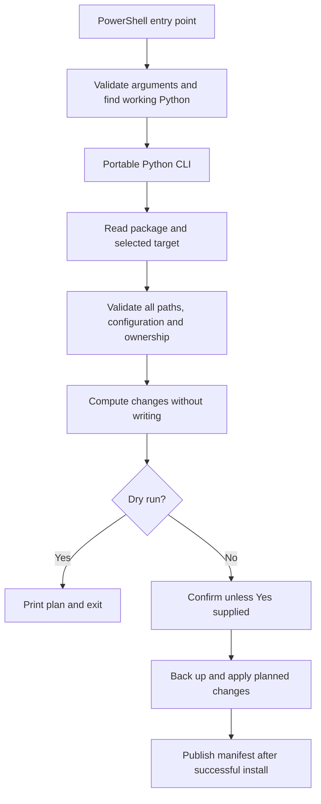

# Architecture: Windows PowerShell installation

Status: approved by the user's `Go` on 2026-11-10. Product brief was also approved; pre-development QA is the next phase.

Input: [PRD-windows-powershell.md](../prd/PRD-windows-powershell.md).

## Outcome and design

Add native PowerShell install, uninstall, and validation commands with a small Python standard-library implementation. Windows installation must never invoke Bash or Unix utilities. Retain the existing Bash entry points and interfaces; avoid a broad rewrite of their lifecycle during this change.

PowerShell owns parameter binding, help, runtime discovery, and native process invocation. Python owns package validation, target preflight, planned file changes, serialization, and lifecycle operations. Reuse `scripts/managed_block.py` for managed-text behavior, extending its text handling compatibly where needed. Use cohesive functions and explicit operation data rather than a framework or class hierarchy.



## Files and responsibilities

| File | Responsibility |
|---|---|
| `install.ps1`, `uninstall.ps1` | Public Windows PowerShell 5.1 commands; strict parameter binding; propagate Python exit status |
| `scripts/python-runtime.ps1` | Shared runtime probing/invocation helper, dot-sourced using `$PSScriptRoot` |
| `scripts/package_cli.py` | `install`, `uninstall`, and `validate` subcommands; lifecycle and target safety; import managed-block functions |
| `scripts/validate_package.py` | Portable package checks extracted from existing embedded Python validation; directly executable and importable |
| `scripts/validate-package.ps1` | Native package-validation entry point, including PowerShell parser checks |
| `scripts/validate-package.sh` | Retain Bash syntax checks and delegate portable package checks to Python |
| `scripts/managed_block.py` | Shared marker validation, pure replacement, atomic text writes, existing CLI compatibility |
| `tests/test_windows_installation.py`, `tests/test_package_cli.py` | Standard-library unittest lifecycle and failure tests; Windows tests invoke real PowerShell processes |
| `tests/run.ps1` | Resolve runtime and run portable/Windows tests; fail on any required test failure |
| `README.md` | Windows prerequisites, commands, text behavior, supported environments, and verification evidence links |

No change to agent contracts, skill workflow, authentication, or external APIs is required. No network dependency or dependency download is introduced.

## Command contracts

```powershell
.\install.ps1 -DryRun
.\install.ps1 -Yes
.\install.ps1 -CodexHome 'C:\Path With Spaces\.codex' -DryRun
.\uninstall.ps1 -CodexHome 'C:\Path With Spaces\.codex' -Yes
.\scripts\validate-package.ps1
.\tests\run.ps1
```

- Installer parameters: `-CodexHome <string>`, `-DryRun`, `-Yes`, `-WithOrganization`, `-Project <string>`, and `-Help`. Uninstaller supports the first three and help. Reserved organization/project options fail explicitly before target writes. Unknown or incomplete parameters fail through PowerShell binding.
- Public PowerShell scripts use `#requires -Version 5.1`, terminating errors for wrapper failures, and explicit process exit codes. `-Help` succeeds without Python or target access. Exit codes: 0 success/help, 1 lifecycle/dependency failure or declined confirmation, 2 invalid/unsupported arguments. PowerShell binding errors need only be nonzero.
- Python CLI uses equivalent long options (`--codex-home`, `--dry-run`, `--yes`, and reserved install options). It is an internal implementation interface, not an additional documented installation method.
- Target precedence: nonempty explicit `-CodexHome`, then nonempty `CODEX_HOME`, then `Path.home() / '.codex'`. Empty explicit values are errors. Resolve relative paths against the invoking working directory; find package files relative to the script, never the current working directory. Do not repurpose or change `HOME` or `CODEX_HOME` in the invoking session.
- Mutating operations prompt once when stdin is interactive and `-Yes` is absent, matching existing Bash behavior. Dry runs never prompt. Automated tests always pass `-Yes` for mutating commands.
- Output distinguishes unchanged, would install/update/remove, installed/updated/removed, and retained modified files. Errors name the failing prerequisite/path and exit nonzero.

## Python runtime discovery

Probe applications in deterministic order: `py -3`, `python`, then `python3`. Invoke each candidate with a short `-c` version/import check; require Python 3.11+ and `tomllib`. Skip WindowsApps alias paths before invocation to avoid opening the Store. A failed or old candidate does not stop discovery of subsequent candidates. If all fail, report the required version and that no functional interpreter was found; create nothing in the target.

Represent the executable and launcher prefix arguments separately. Invoke with PowerShell's call operator and an argument array; never concatenate a shell command or use `Invoke-Expression`. A validated runtime executes Python with `-B` to prevent imported helpers creating bytecode files beside the package. Scripts contain ASCII source where practical, so Windows PowerShell 5.1 does not require a BOM to decode them.

## Data and text contracts

- Install only regular files enumerated under package `agents/` and `skills/`; validate the eight expected agent names and required TOML fields, skill frontmatter, and existing package security constraints before writes. Reject symbolic links/reparse points in copied package trees.
- Keep the existing manifest name and schema: `codex-sdlc-install-manifest.tsv`, UTF-8, one `sha256<TAB>relative/path` row per installed agent/skill file. Hash copied bytes; use forward-slash relative paths so Bash ownership remains interoperable. No version migration is necessary.
- Generate `config_file` values with `json.dumps(str(resolved_agent_path))`, which escapes Windows backslashes and Unicode correctly for these TOML strings. Parse the complete resulting TOML before any write and verify expected registrations in tests.
- Read user text as UTF-8 accepting an optional BOM. For managed edits, preserve the presence/absence of its BOM and its existing uniform CRLF or LF convention; normalize mixed newline input to the first encountered newline style and document that behavior. New files use UTF-8 without BOM and LF. Preserve unrelated text content, with existing managed-block separator normalization allowed. No semantic TOML reserialization of user settings.
- Shared marker handling requires exactly one balanced, correctly ordered pair, or no pair. Reject duplicate, reversed, or unbalanced markers in either managed file. Remove the existing config block in memory before TOML collision checks; reject unmanaged registrations for reserved agent names.

## Preflight, application, and recovery

Preflight reads and validates both `AGENTS.md` and `config.toml`, all copied destinations, generated output, and the complete manifest before copying or deleting anything. Existing managed files must be regular UTF-8 files; a directory in a planned file location is an error. Dry run computes the same plan without creating the target, backups, manifests, or directories, including for a nonexistent target.

Canonicalize the selected target once. Reject a selected target or existing mutation-path component that is a symlink/junction/reparse point, including backup/manifest paths, rather than following it. Check resolved destination containment using path components, not string prefixes. Reject package/target overlap so installation cannot overwrite its own sources. These checks apply to install and uninstall.

Uninstall treats the manifest as untrusted: require a valid SHA-256 and unique, nonempty relative path under `agents/` or `skills/`; reject absolute/drive/UNC paths, backslashes, traversal components, alternate-data-stream colons, and malformed rows before any removal. Resolve every path and enforce containment and no reparse traversal. Remove only regular files whose current byte hash matches the manifest. Report and retain modified files. Remove managed blocks only after both resulting files have passed validation; preserve unrelated content and backups. Remove the manifest last and remove only known empty package directories, without recursively deleting the target.

Before overwriting any changed existing file, back it up under `backups/codex-sdlc/<UTC timestamp>-<unique suffix>/` using its relative path; include changed managed files and an existing manifest. Apply file content using temporary files in each destination directory and `os.replace`; publish the manifest last. Reinstall with no changed content creates no new backups or duplicate blocks. On I/O failure, report the affected operation and backup location and retain existing backups. Whole-install transactional rollback, concurrent installers, and recovery from adversarial concurrent filesystem changes are out of scope; per-file atomic replacement is the recovery boundary.

## Ordered implementation and checks

1. **Pre-development QA gate:** create the acceptance matrix and executable failing tests for the new interfaces. Use only isolated fixture directories. Confirm test syntax and distinguish expected missing-implementation failures from broken tests.
2. **Portable validation/text slice:** extract package validation and extend shared marker/text behavior. Test malformed/reversed markers, BOM/CRLF/Unicode, valid agent TOML, and unchanged existing CLI behavior.
3. **Lifecycle slice:** implement plan/preflight/apply functions and manifest compatibility. Test target precedence, no-write failures, dry run, repeat install, backups, TOML path resolution, modified-file retention, traversal/reparse rejection, and install/uninstall recovery errors.
4. **PowerShell slice:** add runtime helper and entry points. Execute actual Windows PowerShell subprocess tests from repository and target paths containing spaces and Unicode. Check help/unknown options, missing/old/alias runtime discovery, exit propagation, and no Bash invocation.
5. **Documentation and regression slice:** document Windows commands and prerequisites, run both Windows and existing Bash checks in functioning environments, and produce QA evidence mapped to every PRD criterion. Follow QA, independent code review, security, DevOps, and shipping gates in the repository workflow.

Planned Windows validation commands:

```powershell
powershell.exe -NoProfile -File .\scripts\validate-package.ps1
powershell.exe -NoProfile -File .\tests\run.ps1
```

The native validator checks PowerShell syntax using the built-in parser and portable package checks using the selected Python. Tests use unittest and the standard library, requiring no Pester install. Syntax checks do not prove runtime compatibility.

Existing regression commands remain `bash scripts/validate-package.sh` and `bash tests/run.sh`. A functioning Bash/Python 3.11+ environment must be demonstrated before reporting regression success. Availability of `bash.exe`, WSL, Docker, or Git alone is insufficient. If unavailable, record the block; do not silently claim AC-8 passes. PowerShell 7 may be tested with `pwsh -NoProfile -File ...` when available, otherwise label it unverified.

The repository currently has no configured formatter, linter, build system, or coverage command. Report these gaps accurately. Before marking the feature finished or pushing it under the user's coverage rule, propose reliable coverage tooling and obtain the user's decision; do not substitute test counts for 100% coverage or invent a coverage result. QA can record test results independently of that finish gate.

## Environment, risks, and decisions

The discovery host has Windows PowerShell 5.1.26100.9711 and Python 3.12.10. PowerShell 7 is unavailable; `python3` resolves to a WindowsApps alias. Implementation must record actual executed versions and results rather than infer compatibility from these tools' presence.

No production build or deployment is introduced. Execution-policy troubleshooting may document a single-process invocation; no script changes global policy. No global installation is authorized by architecture approval. Permission/file-lock failures remain possible and must be actionable without promising complete rollback.

No blocking design question remains. Acceptance of this architecture selects thin PowerShell entry points, Python 3.11+ standard-library lifecycle logic, and unchanged Bash lifecycle entry points. Frontend/UI specification and UI QA are not applicable. Reply `Go`, `Approved`, or `Proceed` to advance to pre-development QA; do not implement before that phase's approval.
